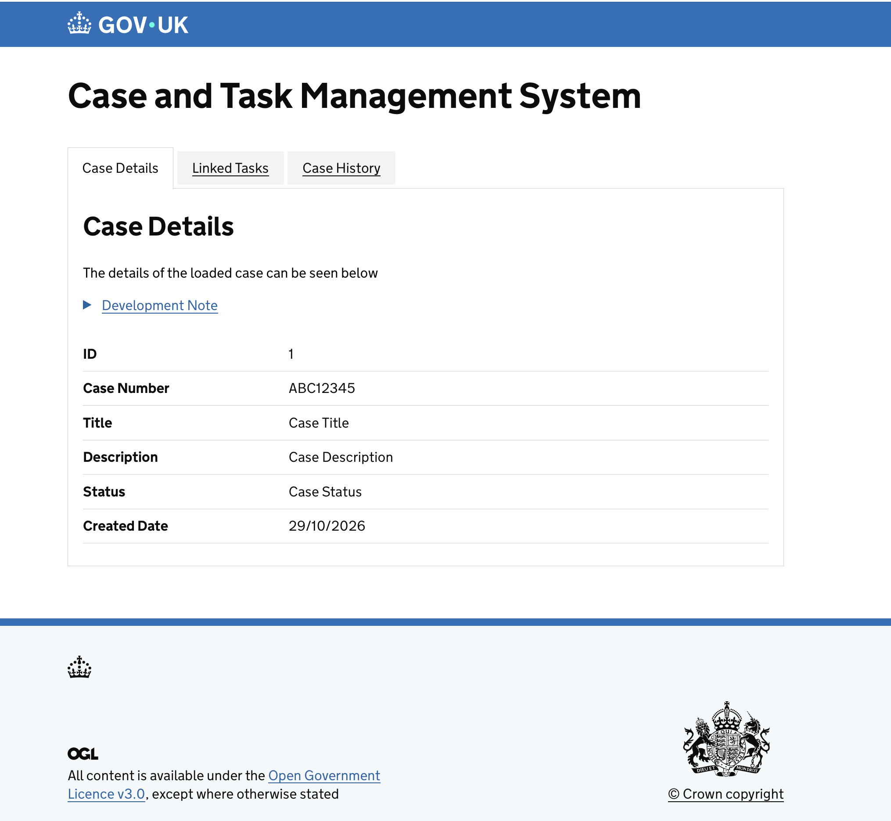
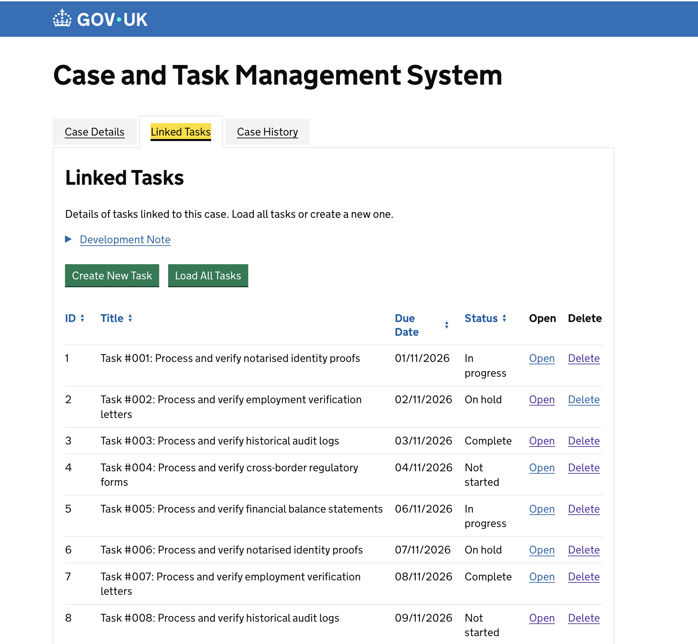
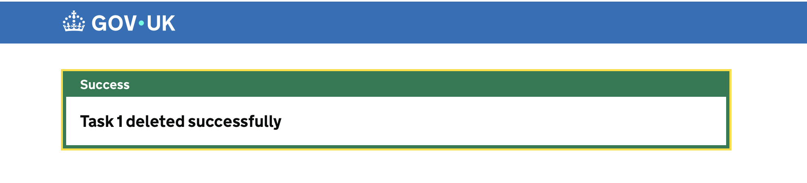
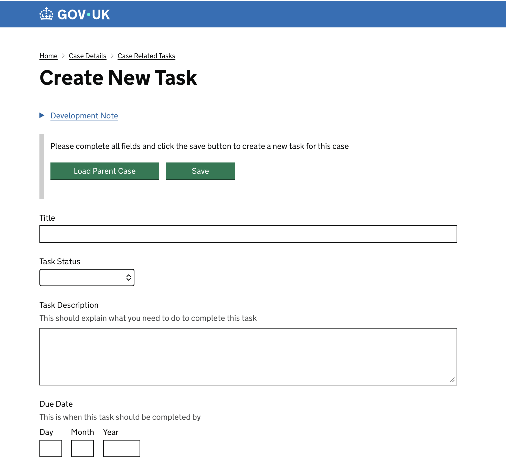

# HMCTS Developer Challenge

A case and task management application with a Java/Spring Boot backend and a TypeScript/Express frontend. The frontend uses GOV.UK Frontend and Ministry of Justice Frontend components, including GOV.UK controls and sortable tables.

# Scope

This is a task-management demonstration, not a complete case-management system:

- Case details come from a fixed example endpoint and are not stored or editable.
- Tasks are associated with the example case (case ID `1`); selecting or managing other cases is not implemented.
- Task titles do not need to be unique, so a case can have multiple tasks with the same title.
- A task requires a title, description, status and due date. The form accepts today or a future date and rejects dates before today.
- A task can be created with any supported status, including **Complete**. Existing tasks, event completed ones, can also have their status changed.  If a real piece of work these requuirements would be confirmed with stake holders.
- Authentication and authorization are not implemented; access and permissions must be added before using this
  application with real case data.

## Screenshots

Here are some screenshots illustrating the use of the Gov Uk Design System (https://design-system.service.gov.uk)









## Prerequisites

- Java 21
- Node.js 18 or later
- Yarn 4.16.0 (the frontend package manager)

## Run locally

Start the backend first. From the repository root:

```sh
cd backend
./gradlew bootRun
```

The backend API runs at `http://localhost:4000`.

In a second terminal, install and build the frontend, then start its development server:

```sh
cd frontend
yarn install
yarn build
yarn start:dev
```

Open `https://localhost:3100`. The development server generates local SSL options when it starts; accept or trust the local certificate if your browser prompts you.

## Tests and checks

Run backend tests:

```sh
cd backend
./gradlew test integration
```

Run frontend unit tests and route tests:

```sh
cd frontend
yarn test:unit
yarn test:routes
```

These backend and frontend unit/route tests start their own test contexts or mock dependencies; you do not need to
start the applications first. To run the frontend browser-functional tests, start the frontend development server
in another terminal, then run `yarn test:functional` from `frontend`.

Backend functional and smoke tests also start the application. From `backend`, run:

```sh
TEST_URL=http://localhost:4000 ./gradlew check -x checkstyleMain functional smoke
```

Port `4000` must be free. If it is in use, choose another port for both the application and test URL, for example
`SERVER_PORT=4001 TEST_URL=http://localhost:4001`.

Build and type-check the frontend:

```sh
cd frontend
yarn build
yarn tsc --noEmit
```

## Project structure

- `backend/` - Spring Boot API and task model/repository
- `frontend/` - Express routes, Nunjucks views, and frontend assets

## Task storage

The backend uses in-memory task storage by default, so task changes are lost when the backend stops. To persist
tasks with SQLite, set `TASK_REPOSITORY=sqlite`. The SQLite database file defaults to `./data/tasks.db`, relative
to the backend working directory. Set `TASK_SQLITE_PATH` to choose another file:

```sh
cd backend
TASK_REPOSITORY=sqlite TASK_SQLITE_PATH=./data/tasks.db ./gradlew bootRun
```

No separate database setup command is needed. When SQLite storage is selected, the backend creates the database
directory if needed and creates the `tasks` table if it does not exist. SQLite task data survives backend
restarts. Case data is still provided by a fixed example endpoint and is not persisted.
